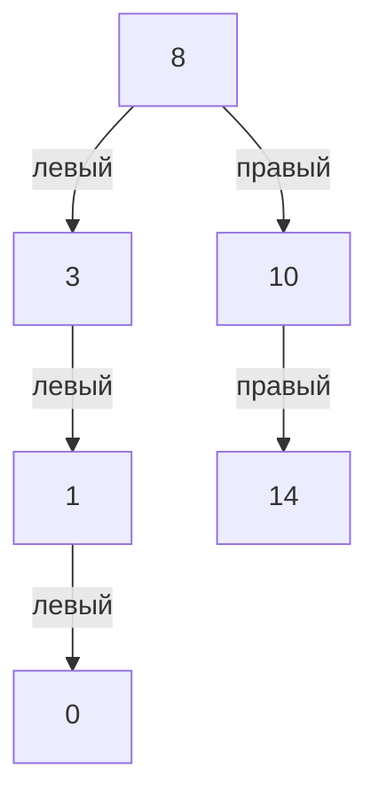

# Задача 3. Balanced Binary Tree

## Условие

Реализовать алгоритм, который определяет, является ли бинарное дерево сбалансированным по высоте. Для каждого узла высоты левого и правого поддеревьев должны отличаться не более чем на 1. Результат — True или False

## Объяснение решения

Класс Node хранит значение узла и ссылки на его детей. Функция is_balanced принимает корень готового дерева и проверяет только его форму: значения узлов не сравниваются, соблюдение правила BST не требуется. Высоту считаем количеством уровней: у пустого поддерева она равна 0, у листа — 1.

Вложенная рекурсивная функция check_height одновременно вычисляет высоту поддерева и проверяет его баланс. Она возвращает неотрицательную высоту, если поддерево сбалансировано, или −1, если внутри найдено нарушение. Отрицательное число используется как сигнал ошибки, поскольку настоящая высота не может быть отрицательной.

Для None функция возвращает 0. Для существующего узла сначала вызывается check_height для левого ребёнка, затем для правого. Каждый вызов имеет свои переменные left_height и right_height. Родитель как бы ждёт завершения вызовов для детей и получает их результаты через return. Если один из результатов равен −1, этот сигнал сразу передаётся выше, без дальнейшего вычисления высоты текущего поддерева.

Когда обе высоты получены, проверяется abs(left_height - right_height). Если разница больше 1, возвращается −1. Иначе высота вычисляется строкой return 1 + max(left_height, right_height): выбирается самая длинная ветка и добавляется один уровень за текущий узел. Общего счётчика нет; высоты передаются от детей к родителям. Каждый узел обрабатывается не больше одного раза, повторного обхода для вычисления высот не требуется.

Проверка начинается с корня. Если check_height возврщает −1, выражение check_height(root) != -1 даёт False; любой результат высоты даёт True. Пустое дерево также считается сбалансированным. Алгоритм корректен, потому что для каждого узла сначала проверяет оба поддерева, а затем разницу их высот. Любое найденное нарушение доходит до корня через сигнал −1. Значения и связи узлов не изменяются.

## Оценка сложности

n — количество узлов, h — количество уровней на самом длинном пути от корня до листа.

| Показатель | Сложность | Объяснение |
| --- | --- | --- |
| Время в худшем случае | O(n) | Каждый узел обрабатывается один раз, высота вычисляется из результатов детей |
| Рабочая память без результата | O(h) | Стек рекурсивных вызовов хранит путь по дереву |
| Память результата | O(1) | Возвращается одно логическое значение |

Общая дополнительная память с учётом результата — O(h). Для сбалансированного дерева стек занимает O(log n), для цепочки — O(n). При обнаружении нарушения оставшиеся ветви могут быть пропущены. Исходное дерево занимает O(n) памяти и не включается в дополнительную память проверки.

На очень глубоком дереве возможен RecursionError из-за ограничения глубины рекрусии Питона, но это техническое ограничение

## Визуализация работы

Используется пример из теста test_nontrivial_inner_violation, который создаётся функцией make_inner_violation_tree:

По форме дерева высота левого подерева корня равна 3, правого — 2. У корня разница допустимая, но у узла 3 слева два уровня, а справа нет детей: разница равна 2. Поэтому проверять только корень недостаточно.

Выполнение начинается со спуска по пути 8 → 3 → 1 → 0. У узла 0 оба ребёнка отсутствуют, и вызовы для них возвращают 0. Затем результаты передаются вверх:

| Шаг возврата | Узел | left_height | right_height | Проверка | Возвращаемое значение |
| --- | --- | --- | --- | --- | --- |
| 1 | 0 | 0 | 0 | Разница 0, баланс соблюдён | 1 + max(0, 0) = 1 |
| 2 | 1 | 1 | 0 | Разница 1, баланс соблюдён | 1 + max(1, 0) = 2 |
| 3 | 3 | 2 | 0 | Разница 2, найдено нарушение | −1 |
| 4 | 8 | −1 | Не вычисляется | Нарушение уже найдено слева | −1 |

Первые две строки показывают вычисление настоящих высот. В третьей строке вместо высоты возвращается сигнал −1. В четвёртой срабатывает проверка left_height == -1, поэтому вызовы для узлов 10 и 14 не выполняются. Высота всего дерева в этом запуске не вычисляется, поскольку для ответа уже достаточно найденного нарушения.

Внешняя функция получает −1 и возвращает False. Это совпадает с ожидаемым результатом теста.

## Тестирование

В тестах проверяются:

- Пустое дерево, один узел и один левый или правый ребёнок
- Полное дерево с одинаковой глубиной всех листьев и сбалансированное дерево с разными высотами поддеревьев
- Разница высот ровно 2 слева и справа
- Нарушения внутри левого и правого поддерева, включая пример из визуализации
- Равные высоты у корня при нарушениях глубже в дереве
- Сбалансированное дерево, которое не является BST
- Одинаковые значения, отрицательные числа и ноль
- Левые и правые цепочки по 200 узлов и сбалансированное дерево из 255 узлов
- Независимость повторных вызовов и сохранность дерева после проверки

Все тесты прошли