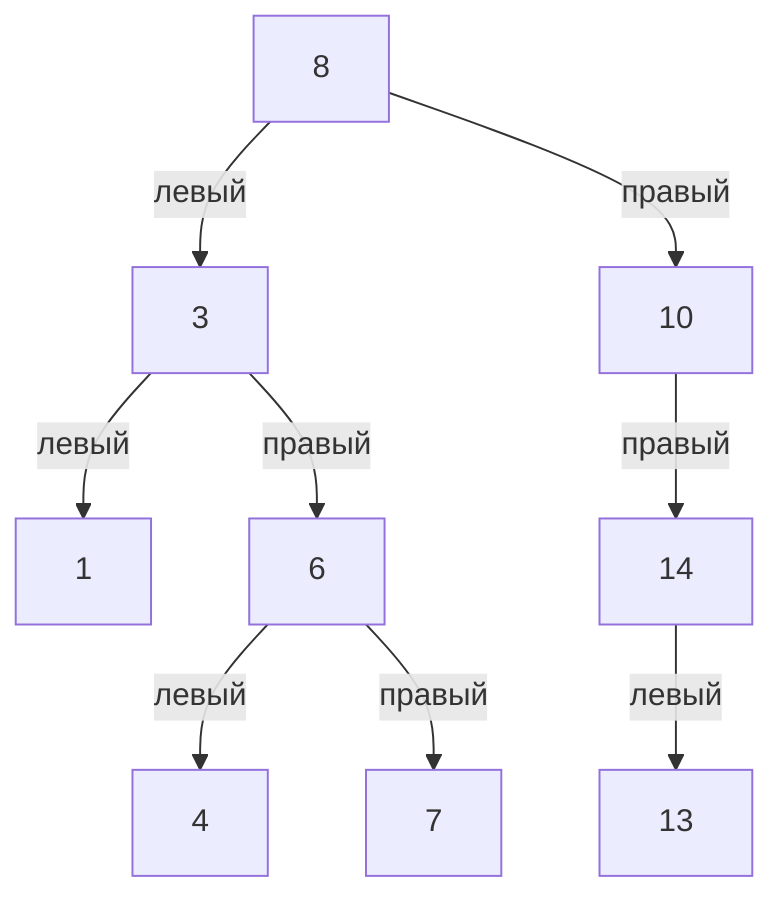

# Задача 1. Tree Traversal

## Условие

Реализовать бинарное дерево поиска и вставку нового элемента с сохранением свойств BST. Реализовать шесть обходов: preorder, inorder, postorder, reverse preorder, reverse inorder и reverse postorder. Каждый обход должен возвращать список значений узлов в порядке посещения

## Оббъяснение решения

### Хранение дерева

Класс Node описывает один узел. В нём хранятся значение value и ссылки на левого и правого ребёнка: left и right. Если ребёнка нет, соответствующая ссылка равна None.

Класс BinarySearchTree хранит ссылку root на корень и методы работы с деревом. У пустого дерева root равен None.

### Вставка

Метод insert использует цикл. Если дерево пустое, новый узел становится корнем. Иначе поиск места начинается с корня:

1. Если вставляемое значение меньше значения текущего узла, переходим влево.
2. Иначе переходим вправо.
3. Если нужного ребёнка нет, создаём на этом месте новый узел и завершаем вставку.

В условии не задано поведение при одинаковых значениях. В этой реализации повторы сохраняются как отдельные узлы: при равенстве движение продолжается вправо. Поэтому для каждого узла значения в левом поддереве строго меньше его значения, а в правом — больше или равны. Это выбранное правило размещения повторов, а не ограничение на входные данные из задания.

Дерево автоматически не балансируется. Его форма зависит от порядка вставки.

### Обходы

Все обходы реализованы рекурсивно. Каждый метод создаёт новый список result и запускает вложенную функцию visit от корня. Если visit получает None, текущий вызов завершается. Иначе функция обрабатывает узел и его поддеревья в нужном порядке.

Обработка узла означает добавление его значения в result. В зависимости от обхода оно происходит до обработки детей, между ними или после них.

| Обход | Порядок действй для каждого поддерева |
| --- | --- |
| preorder | Корень → левое поддерево → правое поддерево |
| inorder | Левое поддерево → корень → правое поддерево |
| postorder | Левое поддерево → правое поддерево → корень |
| reverse preorder | Корень → правое поддерево → левое поддерево |
| reverse inorder | Правое поддерево → корень → левое поддерево |
| reverse postorder | Правое поддерево → левое поддерево → корень |

В reverse-вариантах правое поддерево обрабатывается раньше левого

Все рекурсивные вызовы одного обхода заполняют один список через append. После завершения visit метод возвращает этот список. Обходы не изменяют значения узлов и ссылки между ними.

### Корректность вставки

Изначально пустое дерево удовлетворяет выбранному правилу BST. При вставке каждого значения сравнение определяет поддерево, в котором оно должно находиться. На каждом следующем шаге это значение также удовлетворяет ограничениям всех пройденных предков.

Новый узел добавляется на свободное место и не меняет существующие связи между другими узлами. Поэтому после вставки сохраняется правило: слева находятся меньшие значения, справа — большие или равные. По повторению этого рассуждения дерево остаётся корректным после всей последовательности вставок.

### Корректность обходов

Для пустого поддерева visit ничего не добавляет. Для непустого поддерева функция ровно один раз добавляет значение корня и ровно один раз вызывает себя для каждого ребёнка.

Если вызовы для левого и правого поддеревьев возвращаются после правильной обработки своих узлов, расположение append относительно этих вызовов задаёт нужный порядок для всего поддерева. Это правило применяется от листьев до корня, поэтому каждый узел попадает в результат ровно один раз и в порядке выбранного обхода.

При inorder значения BST получаются в неубывающем порядке, а при reverse inorder — в невозрастающем. Повторы при этом сохраняются.

## Оценка сложности

Обозначения: n — количество узлов, h — количество уровней на самом длинном пути от корня до листа. Для непустого дерева h находится между 1 и n.

Оценки приведены в стандартной модели, где сравнение значений занимает O(1), а append в список — амортизированное O(1).

| Операция | Время | Дополнительная память без результата | Память результата |
| --- | --- | --- | --- |
| Одна вставка | O(h), для пустого дерева O(1) | O(1) | O(1) для нового узла |
| preorder | O(n) | O(h) | O(n) для списка |
| inorder | O(n) | O(h) | O(n) для списка |
| postorder | O(n) | O(h) | O(n) для списка |
| reverse preorder | O(n) | O(h) | O(n) для списка |
| reverse inorder | O(n) | O(h) | O(n) для списка |
| reverse postorder | O(n) | O(h) | O(n) для списка |

При вставке проходим один путь вниз по дереву. Цикл хранит только ссылку на текущий узел и несколько постоянных по размеру данных, поэтому дополнительная память равна O(1).

Каждый обход обрабатывает все n узлов. Глубина стека рекурсивных вызовов равна O(h). Список содержит n значений и занимает O(n). Таким образом, дополнительная память обхода с учётом возвращаемого списка — O(n + h), то есть O(n). Само уже построенное дерево занимает O(n) памяти и считается входными данными для обхода.

Если дерево сбалансировано, h = O(log n), поэтому вставка занимает O(log n), а стек обхода — O(log n). Если дерево вытянуто в цепочку, h = n: вставка и стек обхода требуют O(n). Время полного обхода в обоих случаях остаётся O(n).

Построение дерева последовательной вставкой n значений занимает O(n log n), если высота остаётся O(log n). В худшем случае, например при вставке возрастающих значений, получается цепочка и суммарное время составляет O(n²). Память построенного дерева — O(n), дополнительная рабочая память вставок — O(1).

## Визуализация

Используется пример из теста test_nontrivial_tree. Последовательно вставляются значения: [8, 3, 10, 1, 6, 14, 4, 7, 13]

### Построение дерева

В столбце «Путь» перечислены существующие узлы, с которыми сравнивается вставляемое значение.

| Шаг | Значение | Путь | Изменение дерева |
| --- | --- | --- | --- |
| 1 | 8 | Дерево пустое | 8 становится корнем |
| 2 | 3 | 8 | 3 становится левым ребёнком 8 |
| 3 | 10 | 8 | 10 становится правым ребёнком 8 |
| 4 | 1 | 8 → 3 | 1 становится левым ребёнком 3 |
| 5 | 6 | 8 → 3 | 6 становится правым ребёнком 3 |
| 6 | 14 | 8 → 10 | 14 становится правым ребёнком 10 |
| 7 | 4 | 8 → 3 → 6 | 4 становится левым ребёнком 6 |
| 8 | 7 | 8 → 3 → 6 | 7 становится правым ребёнком 6 |
| 9 | 13 | 8 → 10 → 14 | 13 становится левым ребёнком 14 |

Получается дерево:

### Пошаговое изменение результата inorder

Сначала рекурсия спускается по пути 8 → 3 → 1. Достигнув отсутствующего левого ребёнка 1, она возвращается и добавляет 1 в результат. Далее выполняется то же правило: левое поддерево, текущий узел, правое поддерево.

В таблице показаны моменты выполнения append. Вызовы с None не добавляют значений и отдельными строками не показаны.

| Шаг | Узел | Почему значение добавляется сейчас | result после append |
| --- | --- | --- | --- |
| 1 | 1 | Левого ребёнка нет | [1] |
| 2 | 3 | Левое поддерево с узлом 1 обработано | [1, 3] |
| 3 | 4 | В левом поддереве узла 6 достигнут лист 4 | [1, 3, 4] |
| 4 | 6 | Левое поддерево с узлом 4 обработано | [1, 3, 4, 6] |
| 5 | 7 | Обрабатывается правый ребёнок 6, у него нет левого | [1, 3, 4, 6, 7] |
| 6 | 8 | Всё левое поддерево корня обработано | [1, 3, 4, 6, 7, 8] |
| 7 | 10 | Левого ребёнка нет | [1, 3, 4, 6, 7, 8, 10] |
| 8 | 13 | В левом поддереве узла 14 достигнут лист 13 | [1, 3, 4, 6, 7, 8, 10, 13] |
| 9 | 14 | Левое поддерево с узлом 13 обработано | [1, 3, 4, 6, 7, 8, 10, 13, 14] |

После проверки отсутствующего правого ребёнка 14 оставшиеся вызовы завершаются, и inorder возвращает накопленный список.

### Шаги всех шести обходов

Каждая ячейка содержит значение, добавляемое в result на указанном шаге. После шага k результат состоит из первых k значений соответствующего столбца. В каждом обходе список создаётся заново.

| Шаг добавления | preorder | inorder | postorder | reverse preorder | reverse inorder | reverse postorder |
| --- | --- | --- | --- | --- | --- | --- |
| 1 | 8 | 1 | 1 | 8 | 14 | 13 |
| 2 | 3 | 3 | 4 | 10 | 13 | 14 |
| 3 | 1 | 4 | 7 | 14 | 10 | 10 |
| 4 | 6 | 6 | 6 | 13 | 8 | 7 |
| 5 | 4 | 7 | 3 | 3 | 7 | 4 |
| 6 | 7 | 8 | 13 | 6 | 6 | 6 |
| 7 | 10 | 10 | 14 | 7 | 4 | 1 |
| 8 | 14 | 13 | 10 | 4 | 3 | 3 |
| 9 | 13 | 14 | 8 | 1 | 1 | 8 |

Например, после четвёртого шага preorder результат равен [8, 3, 1, 6], а после четвёртого шага reverse postorder — [13, 14, 10, 7].

Итоговые списки совпадают с ожидаемыми значениями в тесте:

| Обход | Результат |
| --- | --- |
| preorder | [8, 3, 1, 6, 4, 7, 10, 14, 13] |
| inorder | [1, 3, 4, 6, 7, 8, 10, 13, 14] |
| postorder | [1, 4, 7, 6, 3, 13, 14, 10, 8] |
| reverse preorder | [8, 10, 14, 13, 3, 6, 7, 4, 1] |
| reverse inorder | [14, 13, 10, 8, 7, 6, 4, 3, 1] |
| reverse postorder | [13, 14, 10, 7, 4, 6, 1, 3, 8] |

## Тестирование

В тестах попыталась рассмотреть все возмжоные случаи и на конкретные деревья проверяются ожидаемые результаты всех шести обходов

| Тест | Что проверяет |
| --- | --- |
| test_empty_tree | Пустой корень и пустые результаты обходов |
| test_single_node | Дерево из одного узла |
| test_standard_tree | Обычный пример с несколькими ветвями |
| test_nontrivial_tree | Пример из визуализации с разными ветвлениями и уровнями |
| test_duplicate_values | Сохранение повторов и порядок обходов |
| test_negative_values_and_zero | Отрицательные числа и ноль |
| test_right_chain | Цепочка правых детей |
| test_left_chain | Цепочка левых детей |
| test_all_values_equal | Сохранение всех одинаковых значений |
| test_insert_builds_expected_structure | Размещение узлов после вставок |
| test_instances_are_independent | Независимость разных деревьев |
| test_repeated_calls_return_independent_lists | Одинаковые результаты повторных вызовов и независимость возвращаемых списков |
| test_traversals_do_not_change_tree | Сохранение значений, объектов узлов и связей после обходов |
| test_insert_after_traversals | Возможность продолжать вставку после обходов |
| test_long_chain | Все шесть обходов цепочки из 200 узлов |

Все тесты прошли

## Ограничение реализации

Вставка использует цикл, а обходы — рекурсию. Для очень глубокого дерева обход может вызвать RecursionError из-за ограничения глубины рекурсии Python. Тест с 200 узлами проверяет конкретную цепочку но не означает поддержку любой глубины

Это техническое ограничение текущей реализации, а не ограничение размера дерева в условии задания. Для обработки более глубоких деревьев обходы можно реализовать через явный стек
