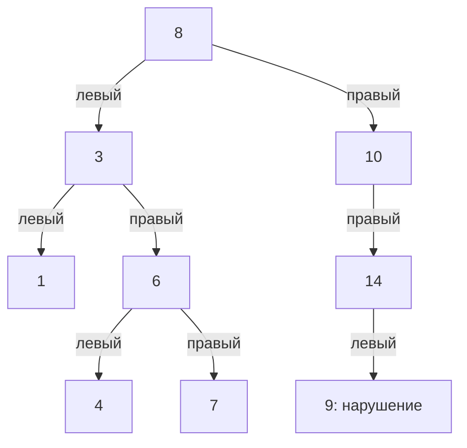

# Задача 2. Validate BST

## Условие

Реализовать алгоритм, который проверяет, является ли произвольное бинарное дерево корректным бинарным деревом поиска. Результат — True или False

## Объяснение решения

Класс Node хранит значение узла value и ссылки на детей left и right. Функция is_valid_bst получает корень уже готового дерева. Для проверки не используется insert: узлы можно соединять произвольным образом, в том числе с нарушением свойств BST.

В условии не уточнено поведение при повторяющихся значениях. Здесь используется то же правило, что в первой задаче: в левом поддереве значения строго меньше значения узла, в правом — больше или равны. Это выбранная договорённость для повторов, а не дополнительное требование задания.

Сравнивать узел только с его детьми недостаточно: значение может подходить родителю, но нарушать ограничение более высокого предка. Поэтому вложенная функция check получает текущий узел и допустимые границы lower и upper. Нижняя граница включается в диапазон, верхняя — нет. None означает отсутствие соответствующей границы.

Если узел равен None, функция возвращает True: в пустом поддереве нет нарушений. Для существующего узла проверяются два условия: значение не должно быть меньше заданной lower и не должно быть больше или равно заданной upper. При нарушении сразу возвращается False.

Если значение подходит, проверяются дети. Левому передаются прежняя lower и значение текущего узла в качестве upper. Правому передаются значение текущего узла в качестве lower и прежняя upper. Те так каждый переход добавляет ограничение от родителя и сохраняет ограничения остальных предков. Проверка начинается с корня без границ: check(root, None, None).

Результаты проверок поддеревьев объединяются через and. Если левое поддерево некорректно, правое уже не проверяется. True возвращается только тогда, когда значение текущего узла и оба его поддерева соответствуют ограничениям. Поскольку границы учитывают всех предков, это проверяет правило BST для всего дерева. Значения и связи узлов не изменяются.

## Оценка сложности

n — количество узлов, h — количество уровней на самом длинном пути от корня до листа. Оценки используют стандартное предположение, что одно сравнение значений занимает O(1).

| Показатель | Сложность | Объяснение |
| --- | --- | --- |
| Время в худшем случае | O(n) | Каждый узел проверяется один раз |
| Рабочая память без результата | O(h) | Стек рекурсивных вызовов хранит путь по дереву |
| Память результата | O(1) | Возвращается одно логическое значение |

Общая дополнительная память с учётом результата — O(h). Для сбалансированного дерева это O(log n), для цепочки — O(n). При раннем обнаружении нарушения алгоритм может проверить только часть узлов; например, ошибка в непосредственном ребёнке корня может быть найдена за O(1). Исходное дерево занимает O(n) памяти и не включается в дополнительную память проверки.

Обход рекурсивный, поэтому на очень глубоком дереве возможен RecursionError. Это ограничение реализации Python, а не условие задачи. Тесты цепочек проверяют глубину 200, но не гарантируют поддержку любой глубины.

## Визуализация работы

Сначала создаётся корректное дерево из make_example_tree, затем значение 13 у левого ребёнка узла 14 заменяется на 9:

В таблице показаны вызовы check для существующих узлов в порядке выполнения. Вызовы для None возвращают True и отдельно не перечислены. lower включается в допустимый диапазон, upper не включается. Отметка «Подходит» относится только к значению текущего узла: после неё проверка поддеревьев продолжается.

| Шаг | Узел | lower | upper | Допустимые значения | Проверка значения |
| --- | --- | --- | --- | --- | --- |
| 1 | 8 | None | None | Любые | Подходит |
| 2 | 3 | None | 8 | Меньше 8 | Подходит |
| 3 | 1 | None | 3 | Меньше 3 | Подходит |
| 4 | 6 | 3 | 8 | От 3 включительно до 8 не включительно | Подходит |
| 5 | 4 | 3 | 6 | От 3 включительно до 6 не включительно | Подходит |
| 6 | 7 | 6 | 8 | От 6 включительно до 8 не включительно | Подходит |
| 7 | 10 | 8 | None | Не меньше 8 | Подходит |
| 8 | 14 | 10 | None | Не меньше 10 | Подходит |
| 9 | 9 | 10 | 14 | От 10 включительно до 14 не включительно | 9 < 10, возвращается False |

Число 9 подходит непосредственному родителю 14 и больше корня 8. Но оно находится в правом поддереве узла 10, поэтому должно быть не меньше 10. Сохранённая нижняя граница позволяет обнаружить эту ошибку.

False возвращается из вызова для узла 9 в вызов для 14, затем для 10 и для корня 8. Оставшиеся ветви в этих вызовах пропускаются из-за and. Итог is_valid_bst — False, что совпадает с ожидаемым результатом теста.

## Тестирование

В тестах проверяются:

- Пустое дерево, один узел и корректное дерево с несколькими уровнями
- Неправильный левый и правый ребёнок
- Нарушения нижней и верхней границ от предков, включая пример из визуализации
- Повторы справа и слева, в том числе на более глубоких уровнях
- Отрицательные числа, ноль и очень большие целые числа
- Цепочка одинаковых значений справа
- Левые и правые цепочки по 200 узлов и ошибка в конце цепочки
- Независимость повторных вызовов и сохранность дерева после проверки

Все тесты прошли