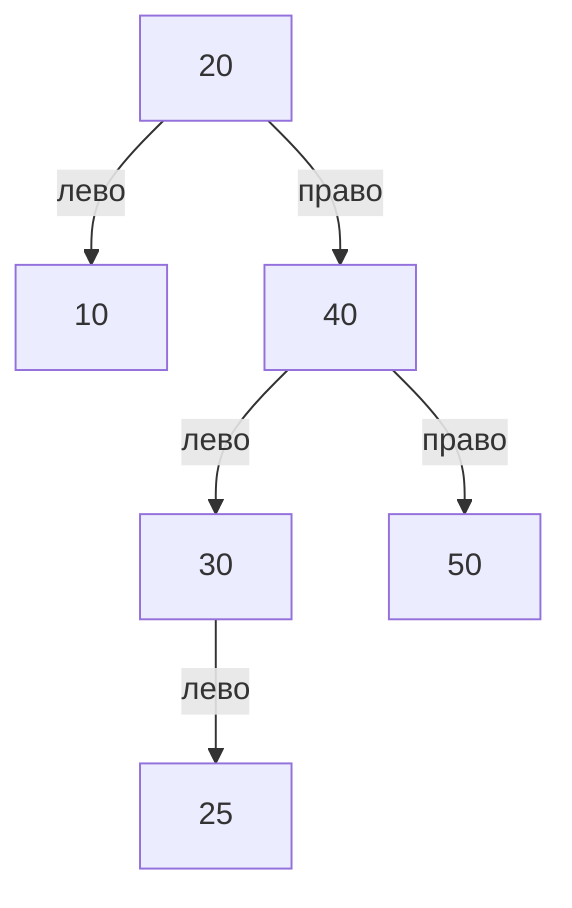
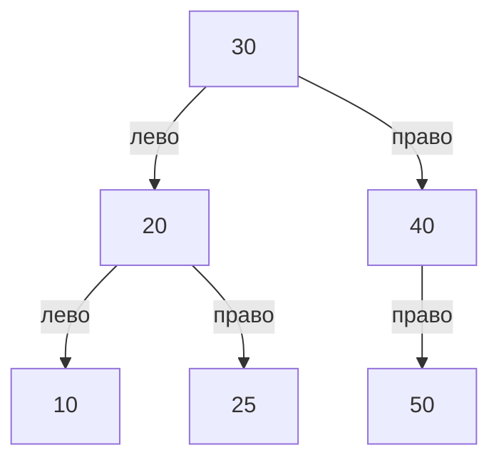

# Задача 3. AVL

## Объяснение решения

В решении используются 2 класса. Node хранит значение, ссылки на детей и высоту узла. В классе AVL находится корень дерева и методы вставки, удаления и поиска. Значения располагаются по правилу бинарного дерева поиска, те все меньшие находятся в левом поддереве а все большие в правом. Повторные значения не добавляются. Для пустого дерева корень равен None.

Помимо порядка значений нужно сохранять баланс. Высота пустого поддерева принята равной 0, высота листа равна 1. Для остальных узлов она вычисляется как 1 + max(высота слева, высота справа). Баланс в этой реализации считается как высота справа минус высота слева. Допустимы значения -1, 0 и 1.

Вставка начинается как в обычном BST. Значение сравнивается с текущим узлом, после чего рекурсивный вызов продолжается слева или справа. На свободном месте создается новый узел. Дальше начинается обратный путь рекурсии, во время которого обновляются высоты и проверяется баланс. Это важно делать после изменения дочернего поддерева, когда его новая высота уже известна.

Восстановление баланса вынесено в метод _rebalance. Если справа стало слишком высоко, выполняется левый поворот. При этом, если правый ребенок наклонен влево, сначала нужен правый поворот у ребенка. Для перекоса влево действия симметричны. Во время поворота меняются связи между узлами, но порядок значений сохраняется. Среднее поддерево переносится к прежнему корню, поэтому оно не теряется. После перестановки связей сначала обновляется высота прежнего корня, затем нового. Метод возвращает новый корень поддерева, а вызывающий код сохраняет его в нужной ссылке. Если поворот произошел у корня всего дерева, обновляется self.root.

Поиск сделан циклом. При совпадении значения возвращается True. Если искомое число меньше текущего, продолжаем слева, иначе справа. Когда вместо узла встречается None, возвращается False. Здесь не нужно ничего пересчитывать на обратном пути, поэтому рекурсивные вызовы не требуются.

При удалении сначала таким же сравнением находится нудный узел. Если у него нет детей, вместо него возвращается None. При одном ребенке на место узла ставится этот ребенок. Если детей двое, значение заменяется минимальным из правого поддерева, после чего тот узел удаляется рекурсивно. У такого преемника нет левого ребенка, но правый может быть, поэтому его нужно сохранить. При возвращении вверх снова вызывается _rebalance. После удаления баланс может нарушиться у нескольких предков, поэтому проверка продолжается до корня. Если удаляемого значения нет, содержимое дерева остается прежним.

Корректность решения опирается на сохранение двух свойств. Поиск места для вставки и замена удаляемого значения преемником сохраняют порядок BST. Повороты также не нарушают этот порядок и восстанавливают допустимую разницу высот. Поскольку на обратном пути обрабатываются все затронутые узлы, после завершения операции дерево остается сбалансированным. Дополнительный метод inorder обходит левое поддерево, текущий узел и правое поддерево, поэтому возвращает значения в отсортированном порядке.

## Сложность

Пусть n обозначает количество узлов. Сравнение значений считается операцией за O(1).

| Операция | Время в худшем случае | Дополнительная память |
|---|---|---|
| Поиск | O(log n) | O(1) |
| Вставка | O(log n) | O(log n) |
| Удаление | O(log n) | O(log n) |
| Обход inorder | O(n) | O(log n) без учета списка ответа |

Высота AVL-дерева составляет O(log n), поэтому поиск и изменения проходят по пути такой длины. Обновление высоты и каждый поворот занимают O(1). Даже если после удаления балансировка нужна на нескольких уровнях, суммарная работа остается O(log n). Поиск преемника в правом поддереве также укладывается в эту оценку.

Вставка и удаление используют стек рекурсии глубиной O(log n). При поиске хранится только ссылка на текущий узел, поэтому дополнительная память постоянная. Само дерево занимает O(n). Для результата inorder отдельно требуется O(n), тк в список добавляются все значения.

## Пример работы

По очереди вставляются числа 30, 10, 20, 40, 50 и 25. Затем выполняется поиск 25 и 99, после чего удаляются 20, 10 и 40.

Для компактной записи дерева в таблице используется форма значение(левое поддерево, правое поддерево). Лист записан одним числом, а символ ~ обозначает отсутствие ребенка. В отличие от отсортированного списка такая запись показывает реальные связи между узлами.

| Шаг | Операция | Корень | Форма дерева после операции | Что произошло |
|---:|---|---:|---|---|
| 1 | Вставка 30 | 30 | 30 | Создан корень |
| 2 | Вставка 10 | 30 | 30(10, ~) | Новый узел добавлен слева |
| 3 | Вставка 20 | 20 | 20(10, 30) | Случай LR: левый поворот у 10, затем правый у 30 |
| 4 | Вставка 40 | 20 | 20(10, 30(~, 40)) | Баланс допустимый, поворот не нужен |
| 5 | Вставка 50 | 20 | 20(10, 40(30, 50)) | Случай RR: левый поворот у 30 |
| 6 | Вставка 25 | 30 | 30(20(10, 25), 40(~, 50)) | Случай RL: правый поворот у 40, затем левый у 20 |
| 7 | Удаление 20 | 30 | 30(25(10, ~), 40(~, 50)) | У узла два ребенка, значение заменено преемником 25 |
| 8 | Удаление 10 | 30 | 30(25, 40(~, 50)) | Удален лист |
| 9 | Удаление 40 | 30 | 30(25, 50) | На место узла поставлен его единственный ребенок 50 |

Сначала подробнее о вставке 25 на шаге 6. До нее корнем является 20. Число 25 проходит вправо к 40, затем влево к 30 и добавляется слева от 30. Перед балансировкой у 20 получается баланс 2, а у его правого ребенка 40 баланс -1.

Дерево после добавления 25, перед восстановлением баланса:

Сначала выполняется правый поворот у 40. Корнем его поддерева становится 30. Затем левый поворот у 20 делает 30 корнем всего дерева. Узел 25 при этом переносится в правое поддерево 20, его связь не теряется.

После двух поворотов дерево выглядит так:

У нового корня высота равна 3. Его левое и правое поддеревья имеют высоту 2, поэтому баланс равен 0. В тесте проверяется вся полученная форма дерева, а не только значение корня.

Перед удалениями поиск 25 проходит через узлы 30, 20 и 25 и возвращает True. Поиск 99 проходит через 30, 40 и 50, затем доходит до пустой ссылки и возвращает False. После этого выполняются три удаления из таблицы. Перед каждым из них тест проверяет реальное количество детей узла. Во всех трех случаях баланс остается допустимым и дополнительные повороты не требуются. Повороты после удаления отдельно проверяются в тесте test_delete_rotations
