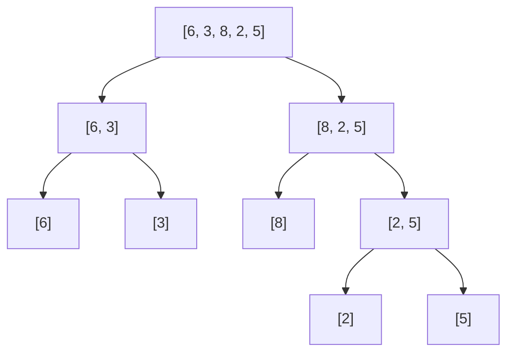
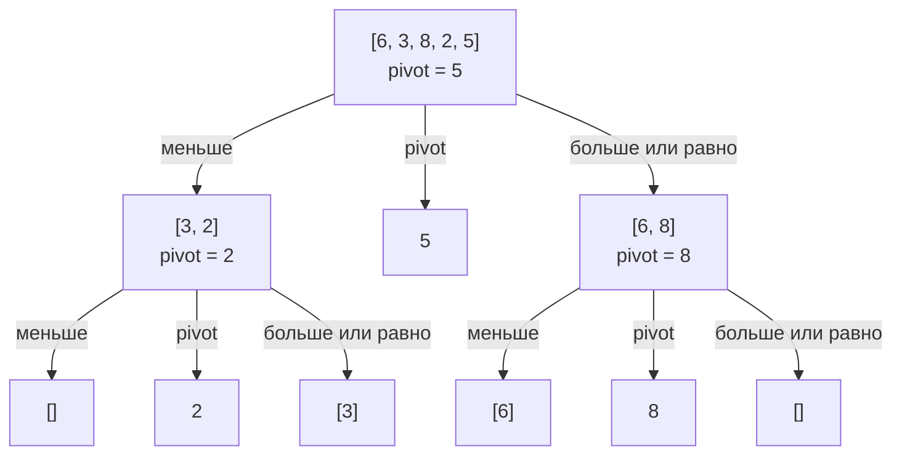

# Задача 1. Compare

## Условие

Нужно реализовать рекурсивные версии Merge sort и Quick sort, написать декоратор для измерения времени выполнения функции и подобрать данные, на которых скорость этих сортировок заметно отличается.

В файле `compare.py` находятся функции `merge_sort`, `quick_sort` и `measure_time`. Обе сортировки принимают список целых чисел и возвращают новый список, отсортированный по возрастанию. Исходный список при этом не изменяется.

## Решение

### Merge sort

Сначала делим список на две части и рекурсивно сортируем каждую из них. Деление продолжается, пока не останутся списки длиной 0 или 1, которые уже считаются отсортированными.

Затем объединяем части обратно. Для этого сравниваем текущие элементы двух отсортированных списков с помощью индексов `i` и `j`. Меньший элемент добавляем в результат и сдвигаем соответствующий индекс. Если элементы равны, сначала берём элемент из левой части. Когда один из списков закончился, добавляем оставшиеся элементы другого.

Таким образом, на каждом шаге объединяются две уже отсортированные части, поэтому итоговый список тоже получается отсортированным.

### Quick sort

Здесь разделяем список относительно опорного элемента (pivot). В моей реализации в качестве pivot берётся последний элемент.

Остальные значения распределяются по двум спискам: в `left` попадают элементы меньше pivot, а в `right` — больше либо равные ему. Потом обе части рекурсивно сортируются и объединяются в порядке `quick_sort(left) + [pivot] + quick_sort(right)`.

После разделения все элементы слева меньше опорного, а справа — не меньше него. Поэтому, когда обе части отсортированы, их можно соединить с pivot и получить правильно отсортированный список.

### Декоратор для измерения времени

Декоратор `measure_time` принимает функцию, запускает её и измеряет продолжительность выполнения с помощью `time.perf_counter()`. Время выводится в секундах с шестью знаками после запятой, а возвращается исходный результат функции. `@wraps(func)` сохраняет имя и другую информацию об оборачиваемой функции.

## Оценка сложности

| Алгоритм | Лучший случай | Средний случай | Худший случай | Дополнительная память |
|---|---|---|---|---|
| Merge sort | O(n log n) | O(n log n) | O(n log n) | O(n) |
| Quick sort | O(n log n) | O(n log n) | O(n^2) | O(n) в среднем, O(n^2) в худшем случае |

У Merge sort список делится примерно пополам, поэтому глубина рекурсии составляет O(log n). На каждом уровне при слиянии суммарно обрабатывается n элементов, откуда получается O(n log n) по времени. Дополнительная память O(n) нужна для срезов и списков, создаваемых при слиянии.

У Quick sort при достаточно равномерных разделениях получается O(log n) уровней и O(n) работы по распределению элементов на каждом уровне. Если pivot постоянно оказывается минимальным или максимальным, одна часть остаётся пустой, а другая уменшьается всего на один элемент. Тогда время становится O(n^2).

В этой реализации Quick sort создаёт отдельные списки `left` и `right` и собирает новый результат, а не сортирует на месте. Поэтому дополнительная память в среднем составляет O(n), а в худшем случае из-за сохранения списков во вложенных рекурсивных вызовах может вырасти до O(n^2).

## Визуализация

Для обоих алгоритмов рассмотрим список `[6, 3, 8, 2, 5]` (из тестов).

### Merge sort

Сначала разделяем список на части:



Теперь сливаем части в обратном порядке:

```text
[6] + [3]              → [3, 6]
[2] + [5]              → [2, 5]
[8] + [2, 5]           → [2, 5, 8]
[3, 6] + [2, 5, 8]     → [2, 3, 5, 6, 8]
```

При последнем слиянии по очереди сравниваем 3 и 2, затем 3 и 5, 6 и 5, 6 и 8. Добавляем 2, 3, 5, 6, после чего переносим оставшуюся 8. Получается `[2, 3, 5, 6, 8]`.

### Quick sort

На каждом шаге выбираем последний элемент текущей части в качестве pivot. Ветки показывают распределение остальных элементов:



После рекурсивной сортировки соединяем части:

```text
[] + [2] + [3]           → [2, 3]
[6] + [8] + []           → [6, 8]
[2, 3] + [5] + [6, 8]    → [2, 3, 5, 6, 8]
```

Результат обеих сортировок одинаковый, но порядок действий различается: Merge sort сначала делит список на части, а затем сливает их; Quick sort сначала распределяет элементы относительно pivot.

## Сравнение и выводы

Для сравнения времени подходят большие массивы, уже отсортированные по возрастанию или убыванию. Обеим сортировкам нужно передавать одинаковые входные данные. При выборе последнего элемента в качестве pivot такие массивы оказываются неудачным случаем для Quick sort: после каждого разделения одна часть пустая, а другая содержит почти все оставшиеся элементы.

Из-за этого на подобных данных ожидается заметная разница: merge sort сохраняет сложность O(n log n), а quick sort переходит к O(n^2). Декоратор позволяет сравнивать продолжительность запуска функций в секундах. Конкретные значения могут отличаться на разных компьютерах и при повторных запусках, поэтому здесь важнее объяснение разницы между алгоритмами, а не отдельные численные замеры.

Pivot можно выбирать не только последним элементом, но и случайно или с помощью медианы трёх. Это помогает реже получать неудачные разделения. Здесь я оставила последний элемент, чтобы худший случай на упорядоченных массивах было проще воспроизвести и объяснить.
