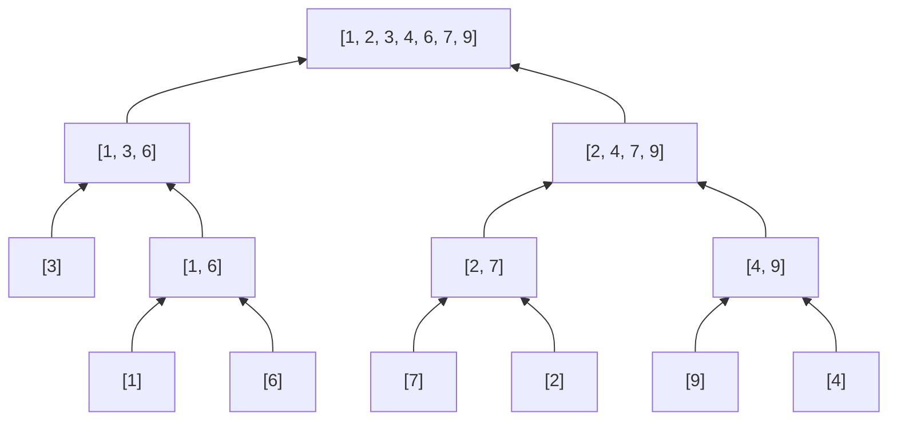

# Задача 2. Iterative

## Условие

Нужно реализовать итеративные версии Merge sort и Quick sort, те выполнить сортировку без рекурсивных вызовов.

В файле `iterative.py` находятся функции `merge_sort` и `quick_sort`. Обе принимают список целых чисел, возвращают новый список, отсортированный по возрастанию, и не изменяют исходные данные.

## Решение

### Merge sort

Использовала сортировку слиянием снизу вверх. В отличие от рекурсивной версии, здесь не нужно делить список до отдельных элементов: сначала каждый элемент уже считается отсортированным блоком длины 1.

В переменной `size` хранится размер блока. В цикле `while` соседние блоки объединяются, после чего `size` увеличивается в два раза. Границы блоков задаются переменными `start`, `middle` и `end`. Через `min()` учитывается ситуация, когда в конце списка остаётся неполный блок.

Для слияния двух блоков используются индексы `i` и `j`. Сравниваем текущие элементы, добавляем меньший в `merged`, а после окончания одного из блоков переносим оставшиеся элементы другого. Отсортированный участок записывается обратно в `result[start:end]`.

Так продолжается, пока размер блока не станет не меньше длины всего списка.

### Quick sort

Для итеративной версии Quick sort использовала стек `stack`, в котором хранятся границы участков, ещё требующих сортировки. Вначале в стек помещается диапазон всего списка.

На каждой итерации `while stack` берём последний добавленный диапазон `(low, high)`. Если в нём меньше двух элементов, сортировка не нужна. В остальных случаях выбираем последний элемент участка как pivot.

Индекс j проходит по текущему участку, а i указывает позицию для следующего элемента, меньшего pivot. При необходимости элементы меняются местами. После прохода pivot ставится на свою окончательную позицию i, и в стек добавляются границы оставшихся частей, если в них больше одного элемента.

В коде сначала добавляется левый диапазон, затем правый. Поскольку стек работает по принципу LIFO, правый диапазон будет обработан первым. Функция не вызывает саму себя: все оставшиеся участки обрабатываются в цикле.

## Оценка сложности

| Алгоритм | Лучший случай | Средний случай | Худший случай | Дополнительная память |
|---|---|---|---|---|
| Merge sort | O(n log n) | O(n log n) | O(n log n) | O(n) |
| Quick sort | O(n log n) | O(n log n) | O(n^2) | O(n) |

Для Merge sort размер блоков удваивается после каждого прохода, поэтому число проходов составляет O(log n). На каждом проходе суммарно обрабатывается O(n) элементов. Отсюда временная сложность O(n log n). Дополнительная память O(n) используется для копии списка и временных частей при слиянии.

У Quick sort за одно разделение рассматриваются элементы текущего участка. При достаточно равномерном выборе pivot число урвней разделения составляет O(log n), а общее время — O(n log n). Если pivot постоянно оказывается минимальным или максимальным, участок уменьшается лишь на один элемент, поэтому в худшем случае получается O(n^2). Например это происходит на уже отсортированных массивах при выборе последнего элемента в качестве pivot.

В `quick_sort` элементы переставляются внутри копии исходного списка, поэтому для неё требуется O(n) дополнительной памяти. Также используется стек диапазонов: при сбалансированных разделениях он занимает O(log n), а в худшем случае может занимать O(n). Общая дополнительная память этой реализации — O(n).

## Визуализация

Рассмотрим список `[7, 2, 9, 4, 1, 6, 3]`. Этот пример включён в тесты.

### Merge sort

Покажем, как отсортированные блоки постепенно объединяются снизу вверх:

Состояние всего списка после каждого прохода:

| Размер блока `size` | Что объединяем | Список после прохода |
|---|---|---|
| 1 | `[7]` + `[2]`, `[9]` + `[4]`, `[1]` + `[6]`; `[3]` остаётся без пары | `[2, 7, 4, 9, 1, 6, 3]` |
| 2 | `[2, 7]` + `[4, 9]`, `[1, 6]` + `[3]` | `[2, 4, 7, 9, 1, 3, 6]` |
| 4 | `[2, 4, 7, 9]` + `[1, 3, 6]` | `[1, 2, 3, 4, 6, 7, 9]` |

### Quick sort

[7, 2, 9, 4, 1, 6, 3] - начало

Здесь важно показать не только выбор pivot, но и порядок обработки участков через стек. В таблице верхушка стека находится справа.

Начальный стек: `[(0, 6)]` — в нём хранится диапазон всего списка.

| Шаг | Извлечённый диапазон и pivot | Список после разделения | Стек после шага |
|---|---|---|---|
| 1 | `(0, 6)`, pivot = 3 | `[2, 1, 3, 4, 7, 6, 9]` | `[(0, 1), (3, 6)]` |
| 2 | `(3, 6)`, pivot = 9 | `[2, 1, 3, 4, 7, 6, 9]` | `[(0, 1), (3, 5)]` |
| 3 | `(3, 5)`, pivot = 6 | `[2, 1, 3, 4, 6, 7, 9]` | `[(0, 1)]` |
| 4 | `(0, 1)`, pivot = 1 | `[1, 2, 3, 4, 6, 7, 9]` | `[]` |

После первого разделения pivot `3` занимает позицию с индексом 2. Осталось отсортировать два участка: `(0, 1)` и `(3, 6)`. Сначала из стека извлекается правый, поскольку он был добавлен последним. После обработки pivot `9` справа остаётся участок `(3, 5)`. При выборе pivot `6` он тоже разделяется, но новых диапазонов длиной больше одного уже нет. В конце обрабатывается оставшийся левый участок `(0, 1)`.

Когда стек становится пустым, сортировка завершена. Оба алгоритма возвращают `[1, 2, 3, 4, 6, 7, 9]`.

## Вывод

Обе сортировки удалось реализовать без рекурсии. В Merge sort вместо рекурсивного разделения используется последовательное объединение блоков, а в Quick sort — собственный стек диапазонов. При этом переход к итеративной реализации не меняет асимптотическую временную сложность самих алгоритмов. Quick sort больше не зависит от ограничения глубины рекурсивных вызовов Python, хотя при неудачном выборе pivot его время по-прежнему может достигать O(n^2).
