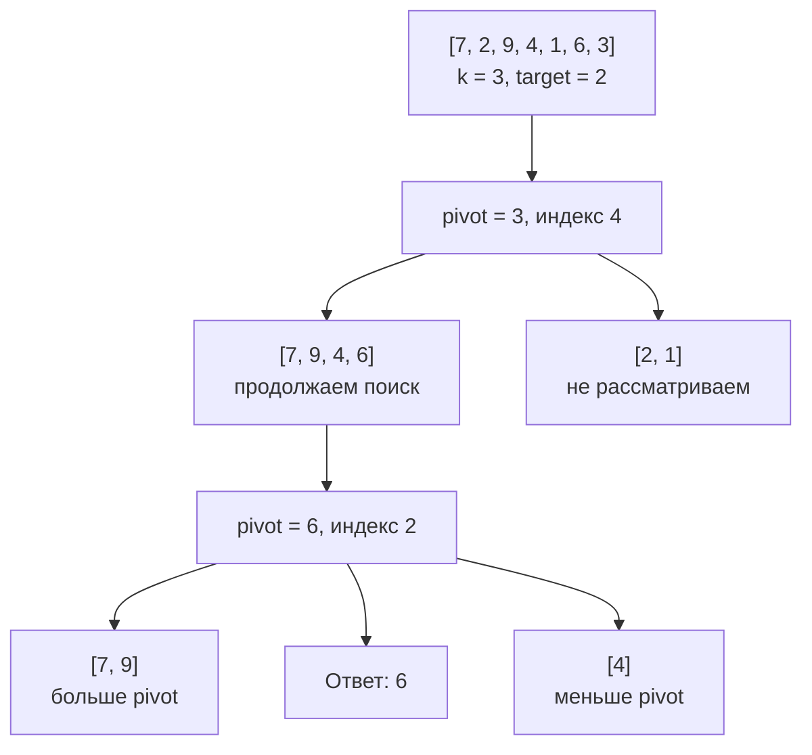

# Задача 3. K-th

## Условие

Нужно найти k-й по величине элемент массива, не сортируя весь массив и не используя кучи. Для решения предлагается применить Quickselect.

В файле `kth.py` реализована функция `find_kth_largest(nums, k)`. Она принимает список целых чисел и номер искомого элемента `k`, начиная с 1, а возвращает соответствующее число. Повторяющиеся значения учитываются как отдельные позиции. Исходный список не изменяется.

## Решение

Я использовала итеративный алгоритм Quickselect. Он похож на Quick sort: выбираем опорный элемент (pivot) и разделяем относительно него текущий участок массива. Разница в том, что после разделения продолжаем работу только с одной частью, где может находится искомый элемент. Полностью сортировать остальные части не нужно.

Сначала проверяется, что `k` находится в диапазоне от 1 до длины списка. При недопустимом значении возникает `ValueError`. Затем создаётся копия массива `result`, а номер искомой позиции переводится в индекс `target = k - 1`. Границы текущего участка хранятся в `low` и `high`.

В каждой итерации цикла `while` последним элементом текущего участка выбирается `pivot = result[high]`. Индекс `j` перебирает элементы участка, а `i` показывает позицию для следующего элемента, большего pivot. Если `result[j] > pivot`, элементы меняются местами, и `i` увеличивается. После прохода pivot переносится на индекс `i`.

Таким образом, слева от pivot находятся элементы больше него, а справа — меньше или равные. Сам pivot занимает ту позицию, на которой он оказался бы при сортировке по убыванию.

Дальше сравниваем `i` с `target`:

- если `i == target`, возвращаем `result[i]`;
- если `i > target`, продолжаем поиск слева, меняя `high`;
- если `i < target`, продолжаем поиск справа, меняя `low`.

Вместо рекурсивных вызовов здесь используется цикл. На каждом шаге область поиска сокращается, пока не найдётся элемент с нужным индексом.

## Оценка сложности

| Случай | Время |
|---|---|
| Лучший | O(n) |
| Средний | O(n) |
| Худший | O(n^2) |

При каждом разделении текущий участок просматривается за линейное время. Если pivot разделяет его достаточно равномерно, то на следующих шагах нужно рассматривать всё меньше элементов: примерно `n + n/2 + n/4 + ...`. Такая сумма даёт O(n), поэтому средняя временная сложность Quickselect — O(n).

В худшем случае pivot каждый раз оказывается крайним по значению, и длина рассматриваемого участка уменьшается только на один элемент. Тогда получается `n + (n - 1) + (n - 2) + ...`, те O(n^2). При выборе послденего элемента в качестве pivot такие разделения возможны, например, на уже упорядоченных массивах.

Дополнительная память составляет **O(n)**, поскольку функция создаёт копию исходного списка. Сам поиск выполняется внутри этой копии с помощью нескольких индексов и переменных, те без учёта копии требует O(1) дополнительной памяти.

## Визуализация

Рассмотрим пример (есть в тестах):

```text
nums = [7, 2, 9, 4, 1, 6, 3]
k = 3
```

Ищем третий по величине элемент. Поскольку индексы начинаются с нуля, `target = 2`.

На схеме показано, какую часть выбираем для дальнейшего поиска после каждого разделения:



Фактические состояния списка после разделений в этой реализации:

| Шаг | Текущие границы | Pivot | Индекс pivot | Список после разделения | Решение |
|---|---|---|---|---|---|
| 1 | `(0, 6)` | 3 | 4 | `[7, 9, 4, 6, 3, 2, 1]` | `4 > 2`, ищем слева: `(0, 3)` |
| 2 | `(0, 3)` | 6 | 2 | `[7, 9, 6, 4, 3, 2, 1]` | `2 == target`, возвращаем `6` |

После первого разделения pivot `3` находится на индексе 4. Нужен индекс 2, поэтому правую часть `[2, 1]` больше не рассматриваем. На следующем шаге pivot `6` оказывается на индексе 2 — это и есть третий по величине элемент. Остальные части массива при этом не обязательно должны быть отсортированы.

## Вывод

Quickselect позволяет найти k-й по величине элемент без полной сортировки массива. После разделения относительно pivot алгоритм продолжает поиск только в нужном участке, поэтому средняя временная сложность составляет O(n). В этой реализации pivot выбирается последним элементом текущего участка, из-за чего в худшем случае время может вырасти до O(n^2). Для уменьшения вероятности таких разделений можно использовать случайный выбор pivot, но здесь оставлен один фиксированный способ выбора.
